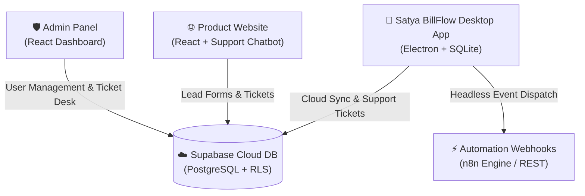

# Satya BillFlow — Enterprise GST Billing & SaaS Management Ecosystem

[](https://github.com/GopeshKachhadiya/Billflow)
[](https://www.electronjs.org/)
[](https://supabase.com/)
[](https://github.com/GopeshKachhadiya/Billflow)
[](https://github.com/GopeshKachhadiya/Billflow)

**Satya BillFlow** is an end-to-end, production-grade billing, GST management, and SaaS ecosystem built specifically for Indian Small and Medium Businesses (SMBs), retail counters, wholesalers, and textile traders. It features a **local-first, ultra-fast Electron desktop client**, a **central Admin Operations Panel**, a **public marketing website**, and a **cloud database sync engine** powered by Supabase PostgreSQL.

---

## 🌟 Ecosystem Overview

Satya BillFlow consists of three seamlessly integrated applications sharing a unified cloud database schema:



### 1. 📱 Desktop Billing Client (`billflow-app`)
* **Local-First High Performance**: Instant SQLite database operations ensures shop counters generate invoices in seconds, even during internet outages.
* **Indian GST Calculation Engine**: Automated CGST, SGST, IGST calculation based on state codes, HSN/SAC lookup, B2B/B2C classification, and GSTR-1 compliance.
* **Invoice Personalization & Branding**:
  * Customizable Invoice Header Tagline (replace hardcoded taglines with custom text).
  * Upload custom **Business Logo**, **Authorised Signature**, and **UPI QR Code** images.
* **WhatsApp & Multi-Channel Billing**: Send automated WhatsApp PDF bills or payment reminders locally via WhatsApp Web or backend automation channels.
* **Print & Export Engine**: Support for standard thermal receipts (3-inch POS) and full-page A4 PDF tax invoices using `PDFKit`.

### 2. 🛡️ SaaS Admin Operations Panel (`billadmin`)
* **Tenant & Subscription Management**: Onboard new SMB users, manage trial periods, track subscription renewals, and issue license keys.
* **Omnichannel Support Ticket Desk**: Centralized helpdesk displaying support tickets submitted across the website contact form, website chatbot, and desktop app.
* **Customer Analytics**: Real-time stats on active users, total revenue, open support tickets, and system health.

### 3. 🌐 Marketing Website & Chatbot (`Billflow-website`)
* **Product Showcase**: Landing pages highlighting offline billing, GST reports, thermal printing, and multi-device sync.
* **Interactive Support Chatbot**: AI-assisted help widget with direct support ticket registration and setup call booking.
* **Contact & Lead Capture**: Embedded contact forms connected directly to the cloud support database.

---

## 🚀 Key Features in v2.4.0

* **Customizable God Name / Header Tagline**: Configurable field in Bill Settings allowing users to customize their invoice header text.
* **Custom UPI QR Code Upload**: Business branding section allows uploading a custom UPI QR code image rendered natively on PDF invoices and preview screens.
* **Unified Support Ticket Pipeline**: Fixed Row-Level-Security (RLS) policies allowing seamless ticket submission from Website and Desktop App directly to the Admin Panel.
* **Backend-Decoupled Webhooks**: Webhook engine reads base URLs and security secrets securely from backend environment variables (`N8N_BASE_URL`, `WEBHOOK_SECRET`).
* **CI/CD Build Resilience**: Production installer builds (`BillFlow_Setup_v2.4_64bit.exe`) dynamically handle missing code-signing certificates on CI runners without failing builds.

---

## 🛠 Tech Stack

| Domain | Technologies |
| :--- | :--- |
| **Desktop App** | Electron v30, Node.js, `better-sqlite3`, `PDFKit`, `QRCode`, `Baileys` |
| **Admin Panel** | React, Vite, TailwindCSS, Supabase JS Client, Lucide Icons |
| **Website** | React, Vite, TailwindCSS, Framer Motion, Lucide Icons |
| **Database & Cloud** | Supabase (PostgreSQL), Row Level Security (RLS), REST API |
| **Automation** | Headless Webhooks, n8n Workflows, Electron `net` Client |
| **Packaging & CI/CD** | `electron-builder`, NSIS Installer (x64), GitHub Actions |

---

## 📂 Repository Structure

```text
Billflow/
├── billflow-app/               # Electron Desktop Application
│   ├── src/
│   │   ├── main.js             # Electron main process & IPC handlers
│   │   ├── preload.js          # Context bridge security layer
│   │   ├── db/                 # SQLite setup, queries, and migrations
│   │   ├── gst/                # GST tax calculation logic & state codes
│   │   ├── n8n/                # Webhook dispatchers for backend automation
│   │   ├── pdf/                # PDFKit invoice generator
│   │   └── renderer/           # HTML/CSS/JS frontend pages & components
│   ├── build/                  # Build resources (icons, pfx certs)
│   ├── dist/                   # Production release installers (BillFlow_Setup_v2.4_64bit.exe)
│   ├── electron-builder.config.js # Electron-builder NSIS packaging config
│   ├── package.json
│   └── supabase_schema.sql     # Full Supabase database schema & RLS policies
├── billadmin/                  # React SaaS Admin Operations Panel
│   ├── src/
│   │   ├── pages/              # Users, Support Tickets, Settings, Analytics
│   │   ├── components/         # Layouts, Sidebar, Navigation
│   │   └── lib/                # Supabase client initialization
│   └── package.json
├── Billflow-website/           # React Public Product Website
│   ├── src/
│   │   ├── pages/              # Home, Features, Pricing, Contact
│   │   └── components/         # SupportChatbot, Navbar, Footer
│   └── package.json
└── README.md                   # Repository documentation
```

---

## ⚙️ Quick Start & Setup Guide

### Prerequisites
* **Node.js**: v20.x or higher
* **npm**: v10.x or higher
* **Git**: Installed locally

### 1. Clone Repository
```bash
git clone https://github.com/GopeshKachhadiya/Billflow.git
cd Billflow
```

### 2. Environment Setup
Create a `.env` file in the root directory (and inside `billflow-app/`, `billadmin/`, `Billflow-website/` as needed):

```env
# Supabase Configuration
SUPABASE_URL=https://your-supabase-project.supabase.co
SUPABASE_ANON_KEY=your_supabase_publishable_anon_key

# Backend Automation Configuration (Optional)
N8N_BASE_URL=https://your-n8n-instance.com
WEBHOOK_SECRET=your_secure_webhook_secret_token
```

### 3. Database Migration
Apply the PostgreSQL schema and Row Level Security policies to your Supabase project by executing the contents of [`billflow-app/supabase_schema.sql`](file:///e:/automation/billflow-app/supabase_schema.sql) in the Supabase SQL Editor.

---

## 🏃 Running Applications Locally

### Desktop Billing App (`billflow-app`)
```bash
cd billflow-app
npm install
npm run dev
```

### SaaS Admin Panel (`billadmin`)
```bash
cd billadmin
npm install
npm run dev
```

### Product Website (`Billflow-website`)
```bash
cd Billflow-website
npm install
npm run dev
```

---

## 📦 Building Production Distributables

To build the 64-bit Windows installer executable (`BillFlow_Setup_v2.4_64bit.exe`):

```bash
cd billflow-app
npm run build:modern
```

The output installer will be generated in `billflow-app/dist/BillFlow_Setup_v2.4_64bit.exe`.

---

## 🔒 Security & Data Privacy

* **Tenant Isolation**: PostgreSQL Row Level Security (RLS) ensures tenant accounts only access their own invoices and business data.
* **Local Data Sovereignty**: All bills, items, and party data remain saved on the user's local disk in SQLite, guaranteeing operation during offline scenarios.
* **Encrypted Credentials**: Cloud connection keys and secrets are loaded securely from environment variables.

---

## 📝 License

Copyright © 2026 **Satya Technologies / Gopesh Kachhadiya**. All Rights Reserved.  
This software is proprietary and confidential. Unauthorized copying, distribution, or reverse engineering is strictly prohibited.